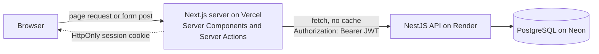
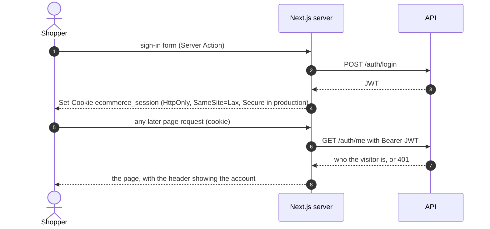
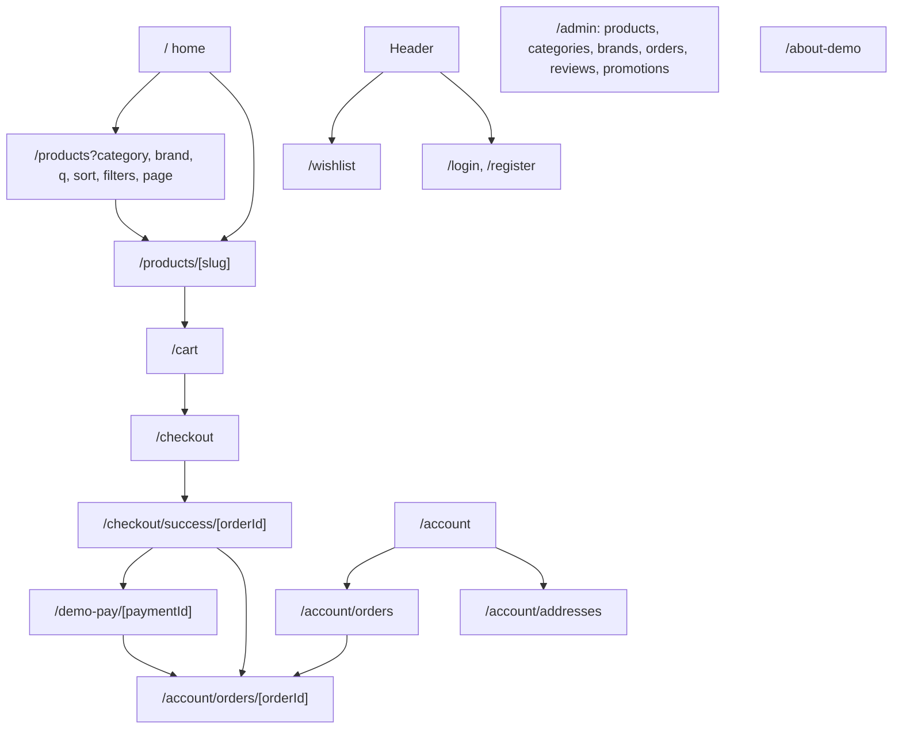
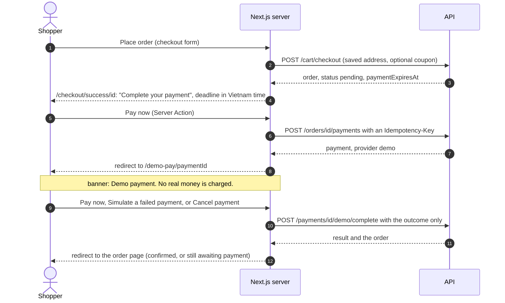

# VERVE STUDIO storefront

The shopper-facing website of a small fashion store, with a staff area for
managing the catalog. It is the frontend of a portfolio project: it talks to a
separate NestJS API (the backend repository), which owns the data, the money
rules and the payments.

- Live demo: <https://ecommerce-frontend-kappa-sage.vercel.app>
- What is real and what is simulated: <https://ecommerce-frontend-kappa-sage.vercel.app/about-demo>
- Backend repository: <https://github.com/misu2tdt/ecommerce-backend> (its README explains the order and payment rules in depth)
- This repository: <https://github.com/misu2tdt/ecommerce-frontend>

The demo store never takes real money. At checkout a visitor pays on a clearly
labelled practice page. The free hosting sleeps when idle, so the first request
after a pause is slow.

**Stack:** Next.js 16 (App Router, React 19, Server Components and Server
Actions), TypeScript, Tailwind CSS 4, the Inter font through `next/font`, and
Playwright for tests. There are no UI or state libraries: the cart, the session
and all data live on the server.

## How the app talks to the API



- **The browser never calls the API.** Pages are rendered by the Next.js server,
  which fetches from the API (`src/lib/api.ts`). Changes (add to cart, place an
  order, pay, review, admin edits) are Server Actions that call the API and then
  redirect or refresh the page. There is no client-side data cache to go stale.
- **Errors are typed.** A failed call throws `ApiError` with the HTTP status
  (`0` for a network failure). Pages turn it into a plain message, and a `401`
  into a redirect to the sign-in page. Backend wording that is meant for
  developers is translated into shopper wording in `src/lib/shopper-messages.ts`.
- **Lists are paged by the backend.** Catalog, order history and the admin lists
  ask for `page` and `limit`; the totals come back in response headers
  (`X-Total-Count`, `X-Total-Pages`, `X-Page`, `X-Limit`) and the body stays a
  plain array (`apiFetchPage`).

## Sign-in and the session cookie



- The JWT is only ever in an **HttpOnly cookie** owned by the storefront. It is
  never in browser storage, in props sent to the browser, or in a URL. Its
  lifetime is the token's own expiry.
- The header asks the API who is signed in on every page. **Only a real `401`
  means signed out.** If that check fails for a passing reason (a rate limit, a
  server error, the network), the header keeps the signed-in view and the reason
  goes to the server log, so a visitor is never shown "Sign In" by mistake
  (`src/features/auth/header-session.ts`).
- The `next` address after sign-in is checked so it can only be an address on
  this site.

## Pages



Public pages: home, catalog, product, About, sign-in, register. Pages that need a
sign-in (cart, checkout, wishlist, account, orders, the payment page) redirect a
signed-out visitor to sign in and back. The `/admin` pages check the role on the
server; a visitor who is not an admin gets an explanation, not the page.

## Checkout and the demo payment



- The order page says "Awaiting payment" until it is paid, with the deadline the
  **backend** gives (`paymentExpiresAt`); after it the backend cancels the order
  and returns the stock. A payment that was started but not finished is picked up
  again from the same pages.
- The amount is never sent by the browser: the payment page shows what the backend
  stored, and the Server Action sends only the outcome.
- With a real provider (MoMo) the same button redirects to the provider's
  checkout; the demo store uses only the practice page.

## Design system

All colour, type and spacing decisions live in design tokens in
`src/app/globals.css` and a few primitives in `src/components/ui`.

- **Tokens:** a neutral palette with one dark brand colour, status colours
  (green success, amber warning, red error and sale), and a type scale
  (`text-caption`, `text-body-sm`, `text-body`, `text-title`, `text-heading`,
  `text-display`). One font family, three weights, loaded once.
- **Primitives:** `buttonStyles` (primary, secondary, ghost, danger and the hero
  variants), badges, eyebrows and form fields. Every button size is at least 44px
  tall.
- **Guards that fail the tests** if a rule is broken: no arbitrary or default
  Tailwind text sizes, no large radii, no off-palette colours, no unloaded font
  weights (`tests/unit/design-rules.spec.ts`); a scan of customer pages for
  developer wording (`banned-terms`); and the date and money formatters below.

## Accessibility and performance practices

What is actually in place, and tested where noted:

- A skip link to the main content; one `h1` per page; headings in order;
  `lang="en"`; every form field has a label; the current page is marked with
  `aria-current` (breadcrumb, pager).
- Touch targets of at least 44px on phones (footer, menu drawer, pager, size
  buttons), and no sideways scrolling at 320, 390, 768 and 1440px (browser tests).
- At least 95% of the text on every page is 14px or larger (a browser test on the
  main pages), and contrast of the hero text is measured against the photo.
- Dialogs and the phone menu trap focus, close on Escape and return focus; after
  moving to another page of a list, focus goes to the start of the results.
- Sizes that are sold out are struck through and `aria-disabled`; choosing nothing
  is answered with an inline message instead of a browser alert.
- Dates are shown in one fixed format in Vietnam time (`src/lib/dates.ts`), the
  same on the server and in the browser, so there is no hydration mismatch; prices
  show the `₫` symbol only (`src/lib/money.ts`).
- Images use `next/image` with reserved space (no layout shift), the first
  pictures load with priority, and Cloudinary is the only allowed remote host.
- Data is fetched and rendered on the server; client components are limited to
  the interactive parts (menus, the gallery and size picker, forms).
- Search engines: `robots.txt`, a sitemap built from the live catalog (it falls
  back to the fixed pages if the API is down), a title and description per kind of
  page, canonical addresses for catalog pages, product data (`schema.org/Product`,
  only real values) and `noindex` for private pages. Set `NEXT_PUBLIC_SITE_URL` to
  the public address; on Vercel the production host is used when it is not set.

## Tests

| Suite | Command | Count (latest run) |
| --- | --- | --- |
| Unit | `npm run test:unit` | 168 tests |
| Browser smoke | `npm run test:smoke` | 129 (127 run; 2 product-photo tests skip when the test database has no photos) tests |

- **Unit tests** are Playwright's runner on plain functions: formatters, status
  words, paging maths, request parameters (checked against what the backend
  accepts), SEO helpers, the header decision, and guard tests that scan the source
  (design rules, no date formatting outside one file, shared navigation lists).
  They cannot render React components, so component behaviour is covered by the
  browser tests.
- **Browser smoke tests** drive a real Chromium against the **real backend** with
  a seeded test database, so they exercise the whole stack: sign in, add to cart,
  check out, pay on the demo page (success, failure, cancel, double click, someone
  else's payment), paging, the product page, the header, SEO output, phone layouts
  and the readable-text, overflow and touch-target guards.
- Tests were written before the code where practical. Checking a test by breaking
  the code on purpose was done by hand while developing; it is not part of CI.
- [CI](./.github/workflows/browser-smoke.yml) builds the backend and this app,
  seeds a fresh database and runs both suites on every push and pull request
  ([lint and unit tests](./.github/workflows/ci.yml) run separately).

## Run it locally

You need Node.js, npm, Docker and the backend repository next to this one. Start
the backend on port 3000 (see its README), then from this folder:

```powershell
npm install
Copy-Item .env.example .env.local      # cmd: copy .env.example .env.local
npm run dev                            # http://localhost:3001
```

Settings (names only; see `.env.example`):

| Name | Needed | Meaning |
| --- | --- | --- |
| `NEXT_PUBLIC_API_BASE_URL` | yes | The backend's address, for example the local one on port 3000. It is checked and frozen into the build. |
| `NEXT_PUBLIC_SITE_URL` | no | The public address of the storefront, for canonical links and the sitemap. |
| `VERCEL_PROJECT_PRODUCTION_URL` | no | Set by Vercel itself; used when the one above is not set. |
| `E2E_BACKEND_DIR` | tests | Where the backend repository is (default `../ecommerce-backend`). |

Checks and tests:

```powershell
npm run lint
npm run typecheck
npm run build                          # needs NEXT_PUBLIC_API_BASE_URL
npm run test:unit
npm run test:smoke
```

The smoke tests start the backend themselves (on port 3000) against the isolated
test database, so set that database's variables for the one command, for example
in cmd:

```bat
set "DB_PORT=5434" && set "ECOMMERCE_TEST_DB_PASSWORD=<local test password>" && set "DB_NAME=ecommerce_test" && set "JWT_SECRET=<any local value>" && set "JWT_EXPIRES_IN=1h" && npm run test:smoke
```

(`DB_HOST` and `DB_USERNAME` default to `localhost` and `postgres`.) Notes:

- Stop your own development backend first. The tests refuse to start if port 3000
  is taken, because reusing it would run them against your development database.
- Seed the test database first with `npm run seed:demo:test` in the backend.
- Before and after a local run the tests cancel the demo customer's unpaid orders
  and refill the seeded stock, so repeated runs do not run the shop out of socks.
  CI starts from a fresh database and skips that.
- Product-photo tests need a test database seeded with photos
  (`DEMO_SEED_TEST_IMAGES=true` for the backend's seed); without them they skip.

## Deployment

The storefront is deployed on **Vercel**, which builds and deploys every push to
`main`. Set `NEXT_PUBLIC_API_BASE_URL` to the public address of the backend
(**Render**, with its database on **Neon**) before the build, and
`NEXT_PUBLIC_SITE_URL` to the storefront's own public address if it has its own
domain. The backend is deployed separately, and its database migrations are a
manual step; the order to follow is in the backend's
[deployment guide](https://github.com/misu2tdt/ecommerce-backend/blob/main/docs/free-deployment.md).

## Known limitations

- **English and Vietnamese dong only**, no translations, no shipping fees or taxes.
- **The payment is a simulation.** There is no real provider in the demo, and no
  refunds.
- **A missing product answers with status 200**, not 404: the page streams a
  loading state first, so the status is already sent. The page says the product
  was not found and is marked `noindex`.
- **Product photos come from one external host** and have to be uploaded and
  seeded separately; without them product cards show a plain placeholder.
- **The size guide is a generic, approximate chart**, not measurements of a
  particular garment.
- **Only a small part of the interface is tested at component level**; the
  browser tests cover flows, layout guards and the main states, but there is no
  automated accessibility scan (such as axe) and no visual-regression testing.
- **The staff area is basic**: tables and forms without search or filters.
- **Free-tier hosting** means cold starts, and the backend's rate limits live in
  one process.
